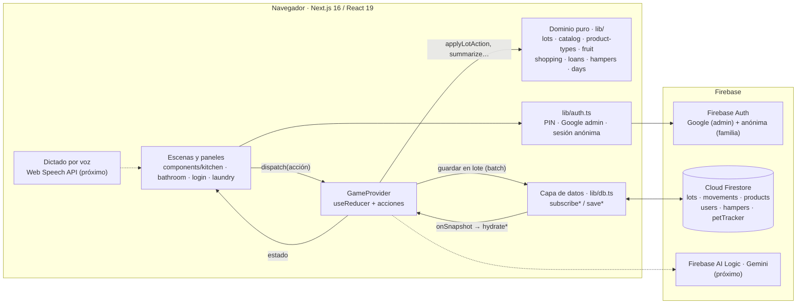
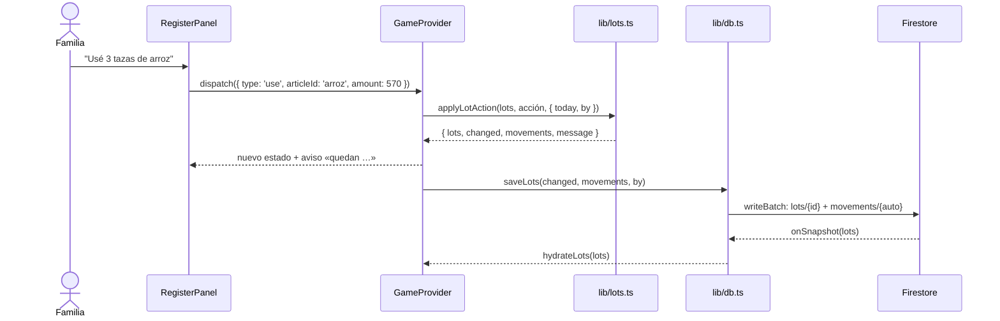
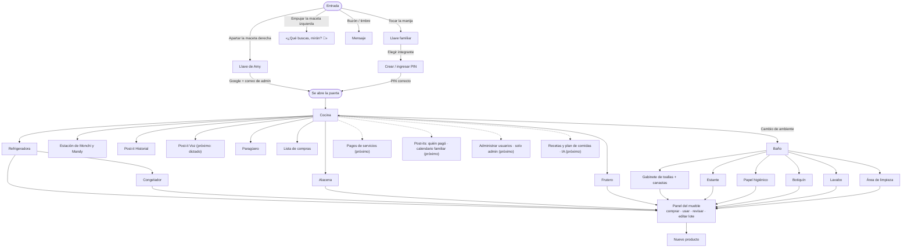
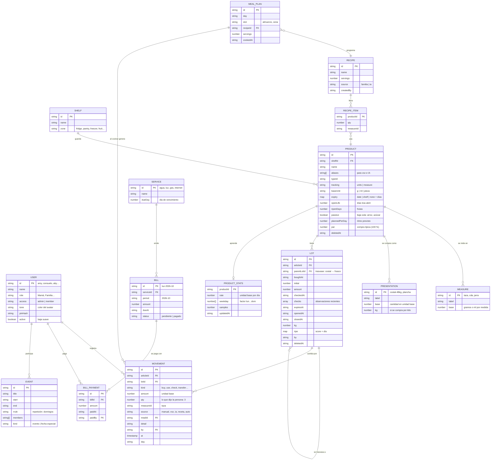
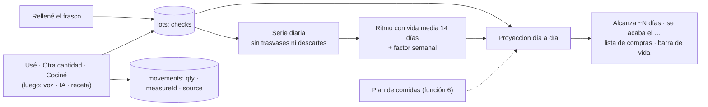
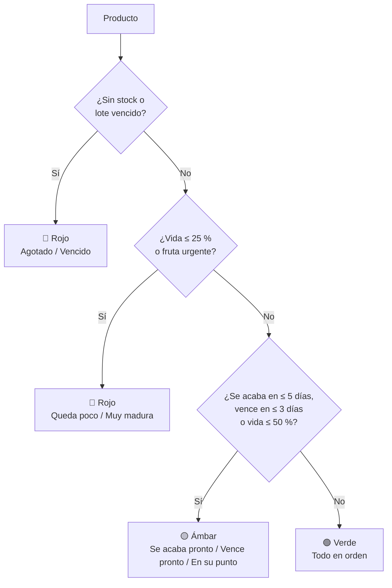
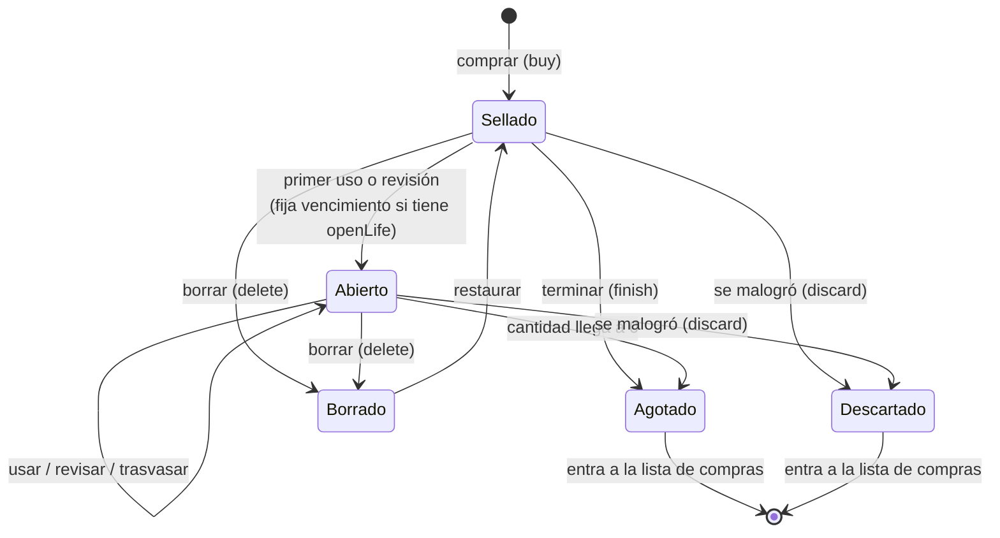

# Casa Peralta · Arquitectura del inventario

Este documento describe **cómo funciona hoy** el inventario de Casa Peralta y **la estructura a la que debe crecer**:
cantidades, medidas, consumo, caducidad, maduración y la barra de vida (semáforo). También explica cómo se conectan las
próximas funciones: consumos variables, pagos de servicios, post-its del mural, gestión de usuarios y la IA.

Los diagramas están escritos en [Mermaid](https://mermaid.js.org/) y GitHub los dibuja solo al abrir este archivo.

**Contenido**

1. [Principios](#1-principios)
2. [Arquitectura de software](#2-arquitectura-de-software)
3. [Navegación del usuario](#3-navegación-del-usuario)
4. [Base de datos](#4-base-de-datos)
5. [Cantidades y medidas](#5-cantidades-y-medidas)
6. [Consumo](#6-consumo)
7. [Caducidad](#7-caducidad)
8. [Maduración](#8-maduración)
9. [Barra de vida y semáforo](#9-barra-de-vida-y-semáforo)
10. [Ciclo de vida de un lote](#10-ciclo-de-vida-de-un-lote)
11. [Escalabilidad y seguridad](#11-escalabilidad-y-seguridad)
12. [Hoja de ruta](#12-hoja-de-ruta)

---

## 1. Principios

Estas reglas ya rigen el código y la estructura nueva las mantiene:

| Principio | Qué significa | Dónde está |
|---|---|---|
| **Cada compra es un lote** | Dos bolsas de cebolla compradas en días distintos son dos lotes; cada uno lleva su cantidad, su fecha y su vencimiento. | `lib/lots.ts` → `Lot` |
| **FEFO** (*first expired, first out*) | Al usar algo, sale primero del lote que vence antes. | `fefo()`, `applyLotAction('use')` |
| **Unidad base** | Todo se guarda en una sola unidad por producto: gramos, mililitros o piezas. Tazas, kilos y frascos son solo formas de ingresar. | `Article.unit`, `Article.tracking` |
| **Aprender de lo real** | El ritmo de consumo sale de observaciones reales (compras, usos, revisiones), no de valores inventados. | `learnRate()` |
| **Historial inmutable** | Todo cambio deja un movimiento que nunca se edita ni se borra. | colección `movements` |
| **Borrado suave** | Nada se elimina: lotes y productos se ocultan con `deletedAt` y se pueden restaurar. | `FIRESTORE.md` |
| **Reglas copiadas** | Un producto copia las reglas de su tipo al crearse; cambiar el tipo después no altera productos existentes. | `lib/product-types.ts` |
| **Lógica pura, sin pantalla** | Los cálculos viven en `lib/` como funciones puras; los componentes solo muestran y despachan acciones. | `lib/*.ts` |

---

## 2. Arquitectura de software

La app es una sola página de **Next.js 16 + React 19** que corre en el navegador. El estado vive en un `GameProvider`
(un `useReducer`) y se sincroniza en tiempo real con **Firebase** (Auth + Firestore). Las funciones marcadas como
*próximo* aún no existen y se muestran para ver dónde encajan.

### Flujo de una acción

Ejemplo: alguien registra que usó 3 tazas de arroz. La pantalla se actualiza al instante (actualización optimista) y
Firestore confirma después; los demás dispositivos lo ven por su suscripción.

### Módulos del dominio

| Módulo | Responsabilidad |
|---|---|
| `lib/catalog.ts` | Muebles (`shelves`), insumos del catálogo (`articles`), presentaciones de compra, botones de uso y formato de cantidades. |
| `lib/product-types.ts` | Plantillas para crear productos nuevos (fresco, congelado, seco, lácteo, fruta…). |
| `lib/products.ts` | Crear, editar, archivar y restaurar productos de la familia. |
| `lib/lots.ts` | Lotes, FEFO, ritmo de consumo, resúmenes (nivel, días restantes, vencimiento) y todas las acciones sobre lotes. |
| `lib/fruit.ts` | Puntuación y etapa de madurez. |
| `lib/shopping.ts` | Lista de compras automática. |
| `lib/dictionary.ts` | Reconoce un nombre escrito y propone tipo y mueble (base para el dictado y la IA). |
| `lib/loans.ts`, `lib/hampers.ts` | Paraguas prestados y canastas de ropa sucia. |
| `lib/db.ts` | Única puerta a Firestore: suscripciones y escrituras por lotes. |

---

## 3. Navegación del usuario

Cada mueble abre un **panel de registro** con las mismas cuatro acciones sobre lotes: **comprar** (crea un lote),
**usar** (descuenta con FEFO), **revisar** («queda ½») y **editar** (corrige un lote a mano, descartarlo o borrarlo).

---

## 4. Base de datos

### Colecciones actuales

| Colección | Documento | Contenido |
|---|---|---|
| `users/{memberId}` | uno por integrante | `pinHash` (SHA-256 de `casa-peralta:{id}:{pin}`), `pinUpdatedAt` |
| `products/{id}` | producto creado por la familia | copia completa de las reglas (`Article`), `deletedAt` |
| `lots/{id}` | una compra | cantidades, fechas, `checks[]` (con `kind` en trasvases y descartes), madurez, `parentLotId` (frasco), `deletedAt` |
| `movements/{auto}` | un cambio | `articleId`, `lotId`, `kind`, `amount`, `detail`, `qty`, `measureId`, `source`, `by`, `at`, `day`; solo se agrega |
| `productSettings/{id}` | ajustes de un producto | `measures[]` (taza, cucharada…) y `container` (frasco), que la familia cambia sin tocar código |
| `hampers/{id}` | canasta de ropa | nivel, ciclos de llenado |
| `petTracker/{YYYY-MM-DD}` | un día | comidas de las gatas marcadas por turno |

Los **160 insumos del catálogo** y los **63 muebles** viven en el código (`lib/catalog.ts`); solo los productos nuevos
de la familia están en Firestore. Los **integrantes** también están en el código (`lib/inventory.ts → family`) y los
**paraguas** solo en memoria (no se sincronizan todavía).

### Modelo propuesto

Mantiene todo lo que ya existe (ningún campo actual cambia de significado) y agrega lo que necesitan las próximas
funciones. Las entidades nuevas están marcadas en la tabla de abajo.

| Colección | Estado | Para qué |
|---|---|---|
| `users` | **ampliar** | Pasa a ser la lista de integrantes (hoy en código): nombre, rol, acceso, color, `active`. Lo administra Amy. |
| `products` | **ampliar** | Guardar también el catálogo (sembrado desde `lib/catalog.ts`), con `presentations` y `aliases`. |
| `productSettings` | ✅ hecho | Medidas de cocina y frasco por producto (en el diagrama: `MEASURE` y la capacidad del recipiente). |
| `lots` | ✅ hecho | `parentLotId` para trasvases (costal de azúcar → frasco). |
| `movements` | ✅ hecho · falta `mealId` | `qty`, `measureId`, `source`: qué dijo la persona y de dónde vino el registro. `mealId` llega con el plan de comidas. |
| `stats/{productId}` | opcional | Caché del ritmo y del patrón semanal. Hoy se calcula al vuelo desde los lotes; solo hará falta si crece mucho el historial. |
| `loans` | nueva | Persistir los paraguas, que hoy solo viven en memoria. |
| `recipes`, `mealPlan` | nuevas | Recetas de la familia o de la IA y su programación en el calendario. |
| `services`, `bills`, `billPayments` | nuevas | Pagos de agua, luz, gas e internet. |
| `events` | nueva | Calendario familiar y fechas especiales. |

---

## 5. Cantidades y medidas

**Regla de oro:** cada producto tiene **una unidad base** y todo se guarda en ella. Lo que la familia dice o toca
(«3 tazas», «un costal de 48 kilos», «el frasco») se convierte al guardar.

| Producto | Unidad base | Medidas para usar | Presentaciones para comprar |
|---|---|---|---|
| Arroz | g | taza = 190 g | costal 25 kg, bolsa 5 kg |
| Azúcar | g | taza = 200 g · frasco = 2 tazas = 400 g | costal 10 kg, bolsa 1 kg |
| Huevos | pieza | 1, 2, 3, 6 | plancha = 30, media plancha = 15 |
| Leche | caja | ¼, ⅓, ½, 1 | caja 1 L |
| Tomate | pieza | 1–4 | kilo (piezas por kilo aprendidas: `learnedPerKg`) |
| Shampoo Sábila | ml | 10, 25, 50 ml | frasco 510 ml |

Las medidas son **datos del producto** (`Measure`: `{ id, label, amount }`, en `lib/catalog.ts`):

- `measuresOf(article, settings)` devuelve, en este orden, las medidas que ajustó la familia (`productSettings`), las
  del catálogo (el azúcar trae taza, cucharada y cucharadita) o la taza deducida de sus botones de uso (arroz: 190 g);
- en el panel de cada producto que se mide en gramos o mililitros, el botón ⚖ **Medidas de la casa** permite pesar
  *su* taza y agregar otras (cucharada, vaso…), y definir el frasco que se rellena;
- `toBase(qty, medida)` es la conversión única que usan los botones, la cantidad libre, «Cociné» y, más adelante, la
  voz, la IA y las recetas: «3 tazas de arroz» → `{ qty: 3, measureId: 'taza' }` → 570 g.

**Trasvases.** El azúcar se compra en costal pero se usa desde un frasco de 2 tazas. Al tocar **Rellené el frasco ·
quedaba Nada / ¼ / ½** se registra un movimiento `transfer`: el costal baja lo que se pasó y el frasco (un lote hijo
con `parentLotId` = costal) sube hasta su capacidad. Los usos salen primero del frasco. La bajada del costal no cuenta
como consumo; lo que el frasco tenía al rellenarlo sí, y así la app aprende cuánto dura un frasco («el anterior duró
8 días»). La capacidad del frasco no suma a la referencia de la barra, para no contar dos veces el mismo azúcar.

---

## 6. Consumo

### Cómo se registra

| Forma | Dónde | Qué guarda |
|---|---|---|
| Botones rápidos | Panel del mueble → **Usé**: ¼ · ½ · 1 · 2 · 3 tazas (o los botones del producto) | un `use` con `qty` y `measureId` |
| Cantidad libre | Panel del mueble → **Otra cantidad**: número + unidad («2,5 tazas», «150 g») | igual, con la equivalencia en gramos |
| Una cocinada | Botón **Cociné** de la cocina: varios ingredientes con su cantidad y una nota opcional («Almuerzo: arroz con pollo») | un `use` por ingrediente con `source: 'cocina'`, en un solo guardado |
| Revisión | **Revisé, queda** Lleno · ¾ · ½ · ¼ · casi nada (en el arroz y el azúcar, se aplica al costal) | un `check` |
| Frasco | **Rellené el frasco · quedaba** | un `transfer` |

Antes, el arroz y el azúcar no tenían botones de **Usé** (solo «Revisé el costal»); ahora sí.

### Cómo se aprende el ritmo (`learnPattern()` en `lib/lots.ts`)

1. **Serie diaria.** Lo que bajó un lote entre dos observaciones se reparte en los días transcurridos (desde que el
   lote se abrió, no desde que se compró). Las bajadas marcadas como trasvase o descarte no son consumo y esos días no
   cuentan como observados. Ventana: 90 días; hacen falta 3 días con datos.
2. **Ritmo que se adapta.** Promedio ponderado con *vida media de 14 días*: lo de hace dos semanas pesa la mitad que
   lo de hoy, así un cambio de hábito se nota pronto.
3. **Patrón semanal.** Con 28 días o más de datos (y al menos 3 de cada día de la semana) se aprende un factor por
   día: si los domingos se cocina el doble de arroz, el domingo pesa ~1,75 y el resto ~0,9.
4. **Proyección.** `projectDays()` simula día a día (ritmo × factor del día) hasta que el stock llega a cero: de ahí
   salen «alcanza ~N días» y «se acaba el …». Sin datos se usa `plannedPerDay` (croquetas: 143 g/día).

**Lo que baja solo.** En los productos pasivos (arroz, azúcar, líquidos de uso) la cantidad baja sola durante los
**días completos sin ningún registro** (ni el día del último registro ni hoy, que aún puede anotarse), y solo en el
lote que se está usando: un costal cerrado no baja. Un uso anotado parte de esa cantidad estimada; si un lote ya se
estimaba vacío, se cierra y se sigue con el siguiente. Así, quien anota cada uso no ve descuentos dobles, y quien no
anota igual ve una estimación razonable.

### Ejemplos con los datos de la casa

| Producto | Consumo real | Ritmo | Proyección |
|---|---|---|---|
| Arroz | 3 tazas diarias × 190 g | **570 g/día** | costal de 48 kg ≈ **84 días** |
| Azúcar | frasco de 2 tazas (400 g) dura «un poco más de una semana» (~8–9 días) | **≈ 45–50 g/día** | costal de 10 kg ≈ 7 meses |
| Croquetas | previsto 143 g/día entre Monchi y Mandy | 143 g/día | costal de 9 kg ≈ 63 días |

**Pendiente (función 6):** cuando exista el plan de comidas, la proyección usará primero lo programado para cada
día y solo después el ritmo aprendido, y cocinar una receta del plan guardará su `mealId`.

---

## 7. Caducidad

Cada producto tiene una regla `expiry` y, opcionalmente, vida tras abrir (`openLife`):

| Regla | Significado | Ejemplos |
|---|---|---|
| `date` | Vence en una fecha que se elige al comprar (los días son la sugerencia). | leche (30 d), zanahoria (14 d), papa (30 d) |
| `shelf` | Dura N días **desde que se abre o se empieza a usar**. | queso, mantequilla (30 d), jugo (5 d), esponjas, cepillos |
| `none` | No vence: solo se controla la cantidad. | arroz, azúcar, sal |
| `openLife` | **Dos fases:** al abrir, vence lo que llegue primero entre la fecha impresa y *abierto + N días*. | productos nuevos de tipo Frasco o Lácteo (mermelada, salsas, yogur creado por la familia) |

Estados (`expiryOf()`): **vencido** (días < 0), **por vencer** (0–3 días), **ok** (> 3 días), **sin fecha**.
Con FEFO, lo que se usa primero es siempre el lote que vence antes. Un lote que se malogra se cierra con `discard`,
que deja su propio registro en el historial. Hoy, sin embargo, `learnRate()` cuenta lo descartado como si se hubiera
consumido (ver la sección 11, punto 8).

---

## 8. Maduración

Solo frutas (`ripenDays` > 0). Cada lote guarda una puntuación y el día en que se midió:

- `0` verde → `1` en su punto → `2` pasada (tope 3).
- La puntuación sube sola: `score + días transcurridos / ripenDays` (`lotScore()`).
- Etapas (`stageOf()`): **verde** < 1 · **en su punto** < 2 · **urgente** ≥ 2.
- El estado de una fruta es el de su lote **más maduro** (es el que hay que comer primero).
- Al revisar («está verde», «en su punto», «muy madura») la puntuación se corrige con el dato real.

---

## 9. Barra de vida y semáforo

Hoy hay tres escalas separadas: el **nivel de stock** (barra), el **vencimiento** y la **madurez**. La estructura
propuesta las une en una sola **vida** de 0 a 100 por producto, con un semáforo y el motivo que lo explica.

**Componentes**

| Componente | Cálculo | Fuente |
|---|---|---|
| Stock | `nivel = 100 × total / referencia`, con `referencia = max(Σ inicial de lotes activos, par)` | `summarize()` (ya existe) |
| Caducidad | `100 × días hasta vencer / días de vida del lote` (desde que se compró o abrió) | lote que vence primero |
| Madurez | `100 × (3 − score) / 3` | `lotScore()` |

**Vida = el menor de los componentes que apliquen.** El motivo es el componente que manda.

**Semáforo.** Reúne en un solo lugar los umbrales que ya usa la app (≤ 25 %, se acaba en ≤ 5 días, vence en ≤ 3 días) y agrega el ámbar por vida ≤ 50 %:

El mismo resultado alimenta la **barra de cada mueble**, el **HUD** de la cocina, la **lista de compras**
(rojo y ámbar de stock) y las **sugerencias de recetas** (priorizar lo que vence o madura primero).

---

## 10. Ciclo de vida de un lote

| Estado | Campos |
|---|---|
| Sellado | `openedAt = null`, `closedAt = null` |
| Abierto | `openedAt` con fecha, `closedAt = null` |
| Agotado / Descartado | `closedAt` con fecha (`amount = 0`); el movimiento dice si fue `finish` o `discard` |
| Borrado | `deletedAt` con fecha; sigue en Firestore y en el historial |

---

## 11. Escalabilidad y seguridad

| # | Situación actual | Riesgo | Propuesta |
|---|---|---|---|
| 1 | El catálogo (160 insumos, 63 muebles) está en el código. | Agregar o ajustar un insumo exige desplegar. | Sembrar `products` desde `lib/catalog.ts` una vez; el código queda como semilla. |
| 2 | `subscribeLots` escucha **toda** la colección `lots`, incluidos los cerrados. | Crece sin límite: cada mes hay más lecturas y más memoria. | Escuchar solo lotes abiertos (`closedAt == null`) y leer los cerrados de los últimos 90 días solo para aprender. |
| 3 | `checks[]` crecía con cada uso dentro del lote. | Documentos cada vez más pesados (un costal de arroz con usos diarios). | ✅ Hecho: el lote guarda las últimas 120 observaciones (unos 4 meses de uso diario); el historial completo sigue en `movements`. |
| 4 | Integrantes en el código (`family`). | Agregar a alguien exige desplegar. | Colección `users` administrada por Amy (función 5 de la hoja de ruta). |
| 5 | Las reglas solo exigen `request.auth != null`, y cada dispositivo abre una **sesión anónima** automáticamente. El PIN se valida en el navegador. | Cualquiera que abra la URL puede leer y escribir el inventario, aunque no sepa un PIN. | Validar el PIN en el servidor (Cloud Function) y marcar la sesión con un *custom claim* (`member`/`admin`); exigir ese claim en las reglas. Activar App Check. |
| 6 | Colecciones en la raíz. | Si un día hay otra casa, sus datos se mezclan. | Prefijo `households/{casaId}/…` cuando haga falta (la capa `db.ts` es la única que cambia). |
| 7 | Paraguas solo en memoria. | Se pierden al recargar. | Colección `loans`. |
| 8 | `discard` cerraba el lote con una observación en 0 que `learnRate()` tomaba como consumo. | Tirar un yogur vencido aceleraba el ritmo aprendido y adelantaba «se acaba el…». | ✅ Hecho: la observación queda marcada como `discard` y no cuenta como consumo. |
| 9 | En los productos pasivos, **todos** los lotes activos bajaban solos, también un costal cerrado. | El arroz mostraba 45,7 kg cuando había un costal de 48 kg sin abrir. | ✅ Hecho: solo baja el lote que se está usando. |
| 10 | Un uso se descontaba de la última cantidad guardada y no de la estimada. | Anotar un uso tras días sin registros «devolvía» lo consumido y el total subía. | ✅ Hecho: el uso parte de lo estimado; ver la sección 6. |

**Corregido en este cambio:** el historial descartaba al leer de Firestore los movimientos `discard` (lote que se
malogró) y `loan`, porque no estaban en la lista de tipos válidos de `lib/db.ts`. Ahora aparecen en el post-it
Historial.

---

## 12. Hoja de ruta

Orden acordado; cada paso se apoya en la estructura de este documento.

| # | Función | Qué agrega a la estructura |
|---|---|---|
| 1 | **Arquitectura del inventario** (este documento) | Modelo, diagramas, reglas de cálculo. |
| 2 | ✅ **Consumos variables** (arroz, azúcar, cocinar) | `productSettings` (medidas y frasco), `transfer`, botón «Cociné», movimientos con `qty`/`measureId`/`source`, ritmo con vida media + factor semanal. |
| 3 | **Pagos de servicios** (nuevo ícono) | `services`, `bills`, `billPayments`: monto, fecha, quién pagó, vencimiento con aviso, historial y gasto por mes. |
| 4 | **Post-its del mural** | «Quién pagó» (lee `bills`) y calendario familiar (`events` con repetición y fechas especiales: Día del Padre, de la Madre, del Ingeniero, del Niño, del Informático, del Agrónomo, del Fotógrafo…). |
| 5 | **Gestión de usuarios** (solo admin) | `users` como fuente de la llave familiar; altas, cambios y bajas suaves. |
| 6 | **IA con Gemini** (Firebase AI Logic) | Dictar compras → `{ producto, qty, medida }` validado con `products.aliases` y `dictionary.ts`; recetas con prioridad por vida (sección 9); `recipes` y `mealPlan`. |
